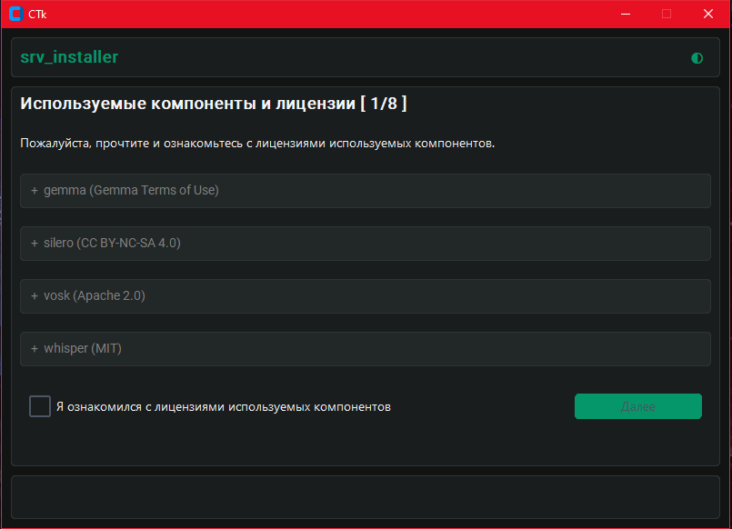
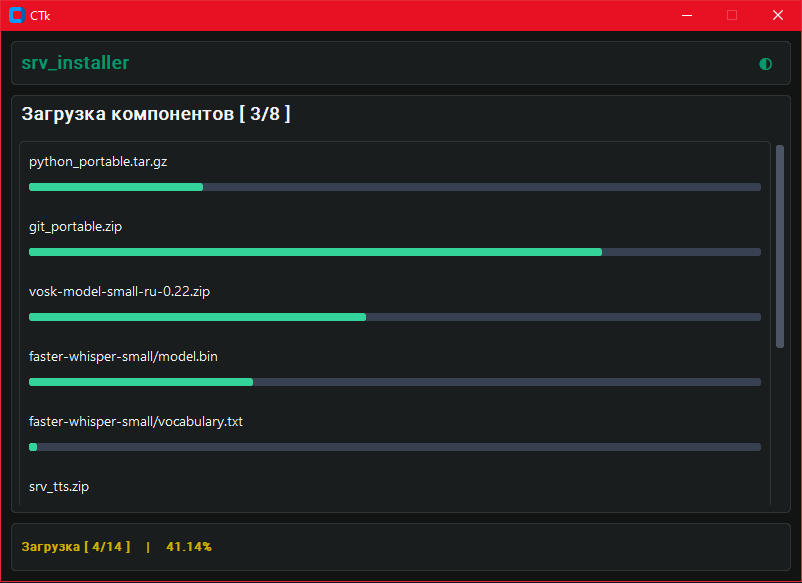
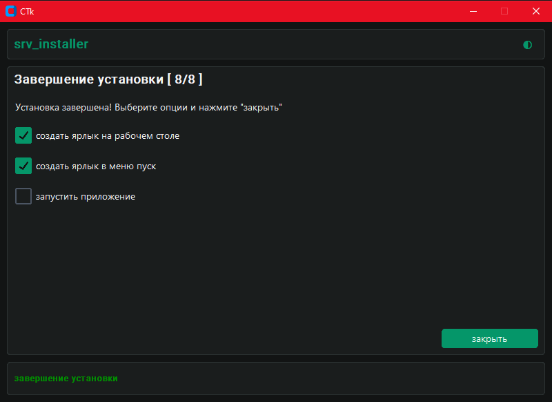

# SRV_INSTALLER

> SRV_INSTALLER — это десктопный установщик для приложений, собранных по «srv-стандарту»: набора из нескольких
> изолированных Python-сервисов (
> например [srv_stt](https://github.com/Mike2024New/srv_stt), [srv_llm](https://github.com/Mike2024New/srv_llm)) и
> одного ui-оркестратора (например [app_ai_assistant](https://github.com/Mike2024New/app_ai_assistant)),
> каждый из которых живёт в своём venv и собирается в отдельный .exe.
> Установщик берёт на себя всё, что обычно делается вручную: скачивает портативные Python и Git, разворачивает сервисы,
> ставит зависимости, собирает бинарники и переносит готовое приложение в выбранную пользователем папку.

---

# Содержание

- [Примечание о безопасности (дисклеймер)](#примечание-о-безопасности-дисклеймер)
- [Зачем это нужно](#зачем-это-нужно)
- [Что делает установщик](#что-делает-установщик)
- [Как устроен srv стандарт](#как-устроен-srv-стандарт)
- [Логи](#логи)
- [Планы](#планы)
- [Лицензии](#лицензии)
- [Примечания](#примечания)

---

## Примечание о безопасности (Дисклеймер)

Проекты srv-стандарта построены на базе экосистемы Open Source и используют компоненты из разных публичных источников:
библиотеки из репозитория [PyPI](https://pypi.org/), языковые модели с [HuggingFace](https://huggingface.co/), голосовые
движки [Silero](https://silero.ai/), [Vosk](https://alphacephei.com/vosk/) и другие.

Большинство из них распространяются под открытыми лицензиями (MIT, Apache 2.0), но важно учитывать специфику
современного ПО: любой компонент тянет за собой длинную цепочку вложенных зависимостей. Проверить каждый сторонний байт,
модель или скрипт до последнего символа физически невозможно — это классический эффект «чёрного ящика», характерный для
большинства ИТ-продуктов в мире.

Это не означает, что перечисленные инструменты опасны. Это означает, что **абсолютная гарантия безопасности невозможна**
для любого проекта, использующего внешние библиотеки.

Устанавливая данное приложение, вы принимаете стандартные риски использования Open Source решений. В целях
информационной гигиены любые экспериментальные локальные ИИ-системы рекомендуется запускать в изолированных окружениях
или на рабочих машинах, отдельно от критически важных личных кабинетов и онлайн-банкинга. Это стандартная рекомендация,
а не признак проблемы.

---

## Зачем это нужно

- **Автоматизация:** избавляет от ручной возни с портативными интерпретаторами, venv и PyInstaller.
- **Дружелюбность:** превращает сложный процесс из 20 терминальных команд в понятный мастер установки для обычного
  пользователя.

---

## Что делает установщик

Сборщик собирает приложение на основании файла `settings.json`.
Список из 8 шагов мастера — по одному пункту на страницу:

1. **Лицензии** — показывает лицензии всех встраиваемых компонентов (модели, библиотеки). Кнопка далее активируется
   только после ознакомления с ними.
2. **Параметры установки** — выбор целевой директории.
3. **Загрузка компонентов** — параллельное скачивание Python, Git, репозиториев сервисов и моделей с живым прогрессом.
   Загрузчик устойчив к нестабильным интернет соединениям (количество попыток и таймауты задаются в `settings.json`).
4. **Распаковка** — извлечение zip/tar.gz архивов.
5. **Сборка компонентов** — создание venv для каждого сервиса, установка зависимостей, сборка `.exe` через PyInstaller.
6. **Перемещение** — перенос готовых сервисов и ресурсов в целевую директорию.
7. **Очистка** — удаление временных файлов (портативного Python, Git и исходников сервисов).
8. **Завершение** — создание ярлыков (Desktop / Start Menu)
   и опциональный запуск приложения.

---

## Как устроен srv-стандарт

Установщик автоматически подхватывает любой сервис, который соответствует srv-стандарту:

- в корне лежат `LICENSE`, `README.md`, `start.py`, `cli.py`;
- `start.py sync` — ставит зависимости;
- `cli.py build` — собирает `.exe` через PyInstaller;
- папка `resources/` — опционально для моделей и данных.

В репозиториях Mike2024New, репозитории соответствующие этим критериям отмечаются префиксом srv_, например
srv_llm

---

## Логи

Если сборка какого-то сервиса упадет, детальный стек ошибки всегда будет в директории `logs`.

---

## Планы

- [ ] Добавить кнопку отмены на всех этапах установки.
- [ ] Проверка SHA256 скачиваемых ассетов.
- [ ] Кроссплатформенность (Linux).

---

## Лицензии

* Этот проект распространяется под лицензией MIT. Подробнее в файле [LICENSE](LICENSE).
* Иконки приложения взяты из [Tabler Icons](https://tabler-icons.io) и распространяются под лицензией MIT.

---

## Примечания

- Пока работает только на Windows 10/11
- Проект использует утилиты из репозитория [infrastructure2](https://github.com/Mike2024New/infrastructure2).
- Мог забыть где-то поставить запятые, поэтому ставлю их здесь (,,,,,,,,,,,,,,,,,,,,,,,,,,), с запасом.